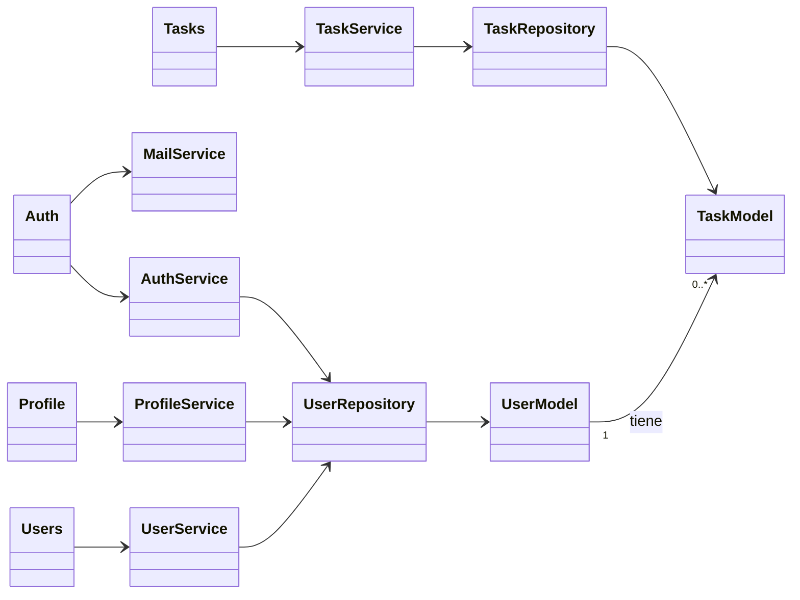

# Sistema organizador de tareas escolares

**Autor:** Marcos Guerra
**Curso:** Algoritmos
**Universidad:** Universidad Mariano Gálvez de Guatemala, Facultad de Ingeniería en Sistemas de Información y Ciencias de la computación

Aplicación web para organizar tareas escolares. Incluye registro con activación por correo, inicio de sesión, recuperación de contraseña, perfil con imagen, gestión de usuarios (administrador) y un CRUD de tareas, con interfaz en inglés y español.

## Tecnologías

| Componente | Tecnología |
|---|---|
| Framework | CodeIgniter 4 (PHP) |
| Motor de plantillas | Blade (`illuminate/view`) |
| Base de datos | MariaDB, administrada con phpMyAdmin |
| Estilos | Bootstrap 5 (CDN) |
| Correo | SMTP (Brevo) |
| Sistema operativo | Ubuntu en VirtualBox |
| Control de versiones | Git y GitHub |

## Arquitectura

Arquitectura monolítica cliente/servidor de 3 capas y 1 nivel.

```
Navegador -> Controlador -> Servicio -> Repositorio -> Modelo -> MariaDB
                 |
                 +-> Vista (Blade) -> Navegador
```

| Capa | Responsabilidad | Carpeta |
|---|---|---|
| Presentación | Vistas Blade (HTML y CSS) | `app/Views` |
| Lógica de negocio | Controladores y servicios | `app/Controllers`, `app/Services` |
| Enlace de datos | Repositorios y modelos | `app/Repositories`, `app/Models` |

Otras carpetas: `app/Filters` (autenticación, administrador, idioma, Remember me), `app/Language` (inglés y español), `app/Database/Migrations` (estructura de la base de datos).

## Funcionalidades

- **Bienvenida** con selector English/Español que conserva la página actual.
- **Registro** con correo de activación (el enlace vence en 24 horas).
- **Inicio de sesión** con Remember me y mensajes de inicio y cierre de sesión.
- **Recuperación de contraseña** por correo (el enlace vence en 1 hora).
- **Perfil:** editar datos (pide la contraseña), cambiar contraseña, subir y eliminar imagen con avatar por defecto.
- **Usuarios (solo administradores):** listado paginado (Newer/Older), crear, ver, editar y eliminar.
- **Tareas:** crear, ver, editar, eliminar, búsqueda y paginación. Cada usuario ve solo las suyas.

## Seguridad e integridad de datos

- Contraseñas con `password_hash`; los tokens se guardan como hash SHA-256.
- Salida escapada en las vistas (`{{ }}` de Blade) contra XSS.
- Filtros `auth` y `admin` protegen las rutas, no solo el menú.
- Correo único y llave foránea `tasks.user_id` con `CASCADE`.
- No se puede eliminar el propio usuario ni dejar el sistema sin administradores activos.
- El archivo `.env` no se sube al repositorio.

## Requisitos

- Ubuntu o Lubuntu 22.04 o superior (probado en Ubuntu 24.04 sobre VirtualBox)
- PHP 8.1 o superior con las extensiones `intl`, `mbstring`, `xml`, `curl`, `mysql`, `gd` y `zip`
- MariaDB o MySQL
- Composer
- Git

## Instalación

### 1. Paquetes del sistema

```bash
sudo apt update
sudo apt install -y git unzip curl composer mariadb-server apache2 phpmyadmin \
  php php-cli php-intl php-mbstring php-xml php-curl php-mysql php-gd php-zip
```

### 2. Clonar el proyecto

```bash
git clone https://github.com/mguerrap7-afk/proyecto_finalmg.git
cd proyecto_finalmg
composer install
```

### 3. Crear la base de datos

```bash
sudo mariadb
```

```sql
CREATE DATABASE proyecto_final CHARACTER SET utf8mb4 COLLATE utf8mb4_unicode_ci;
CREATE USER 'taskappd'@'localhost' IDENTIFIED BY 'TU_CLAVE';
GRANT ALL PRIVILEGES ON proyecto_final.* TO 'taskappd'@'localhost';
FLUSH PRIVILEGES;
EXIT;
```

### 4. Configurar el entorno

```bash
cp .env.example .env
nano .env
```

Reemplaza los valores `CAMBIAR` por los tuyos:

| Variable | Qué poner |
|---|---|
| `database.default.username` | `taskappd` |
| `database.default.password` | la clave del paso anterior |
| `email.fromEmail` | remitente verificado en tu proveedor SMTP |
| `email.SMTPUser` y `email.SMTPPass` | credenciales SMTP (por ejemplo Brevo) |

Los valores con espacios van entre comillas, por ejemplo `email.fromName = "Tareas escolares"`.

### 5. Crear las tablas

```bash
php spark migrate
```

### 6. Carpeta de imágenes

```bash
mkdir -p public/uploads/profiles
```

### 7. Ejecutar

```bash
php spark serve
```

Abre `http://localhost:8080`.

## Primer administrador

1. Regístrate en `/signup` y activa la cuenta con el enlace del correo. Si el envío falla, el enlace queda en `writable/logs/`:
```bash
   grep "Activation link" writable/logs/*.log | tail -1
```
2. En phpMyAdmin (`http://localhost/phpmyadmin`), tabla `users`, cambia `is_admin` a `1` en tu fila.
3. Cierra sesión y vuelve a entrar. Aparecerá **Usuarios** en la barra.

## Estructura del proyecto

```
app/
- Controllers/    Auth, Home, Language, Profile, Tasks, Users
- Services/       AuthService, ProfileService, TaskService, UserService, MailService
- Repositories/   UserRepository, TaskRepository
- Models/         UserModel, TaskModel
- Filters/        AuthFilter, AdminFilter, RememberFilter, LocaleFilter
- Helpers/        blade_helper.php
- Language/       en/, es/
- Database/       Migrations/
- Views/          layouts/, auth/, tasks/, profile/, users/ (archivos .blade.php)
```

## Diagrama de clases

Resumen de la relación entre capas:




- Máquina virtual con Ubuntu en VirtualBox
- Pantalla de bienvenida (inglés y español)
- Registro, correo de activación e inicio de sesión
- Perfil, usuarios y tareas
- Tablas en phpMyAdmin